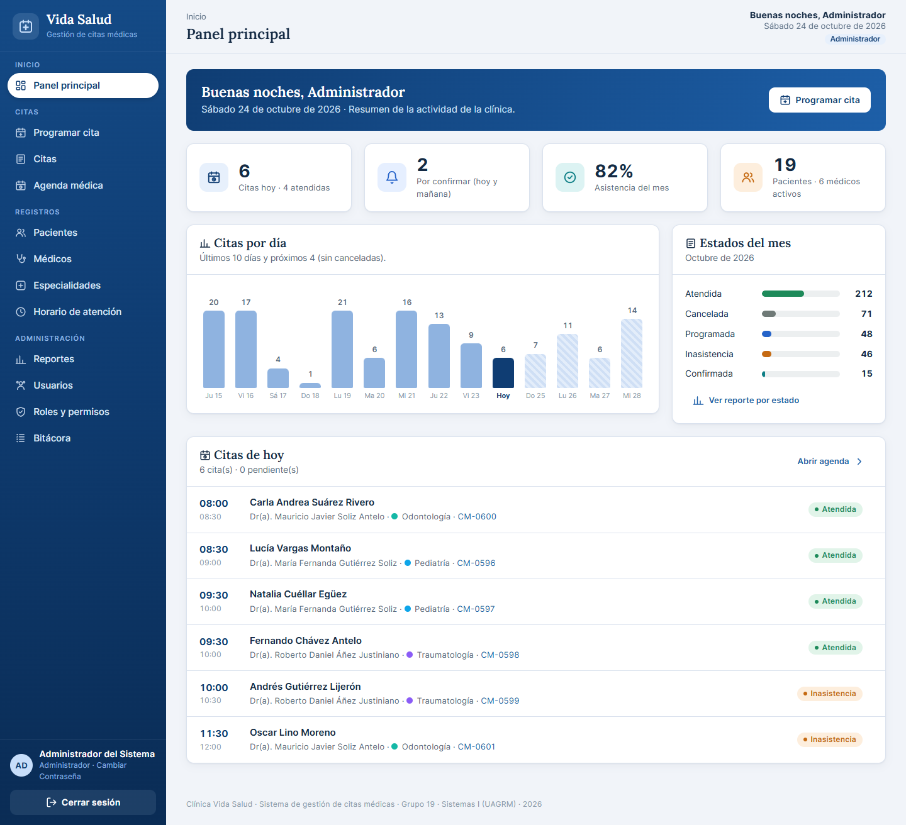

# Clínica Vida Salud · Sistema Web de Gestión de Citas Médicas

Sistema web para la **Clínica Vida Salud** (Santa Cruz, Bolivia): pacientes, médicos, especialidades, horarios,
programación de citas **sin cruces de horario**, agenda médica, portal del paciente, reportes y bitácora.

**Examen 2 · Sistemas de Información I · UAGRM** — MSc. Ing. Angélica Gazón Cuéllar · **Grupo 19** · 2026

| | |
|---|---|
| Backend | PHP 8.1+ sin frameworks · PDO + `pdo_pgsql` · organizado por paquetes y casos de uso |
| Frontend | Plantillas PHP (HTML5) · CSS3 propio · JavaScript puro · fuentes Inter y Lora incluidas · sin CDN |
| Base de datos | PostgreSQL 13+ normalizada: tablas, restricciones, `EXCLUDE`, funciones, triggers y vistas |
| Servidor | Apache (XAMPP) en `http://localhost/clinica-vida-salud` · o `php -S` con `backend/public/router.php` |



---

## Cómo levantar el sistema

### Paso 1 · Requisitos (una sola vez)

1. Instale **XAMPP** (PHP 8.1 o superior), **PostgreSQL** (13 o superior) y **VS Code**.
2. En `C:\xampp\php\php.ini` quite el `;` del inicio de estas líneas y guarde:
   ```ini
   extension=pdo_pgsql
   extension=pgsql
   extension=curl
   ```
3. En `C:\xampp\apache\conf\httpd.conf`:
   - quite el `#` de `LoadModule rewrite_module modules/mod_rewrite.so`;
   - dentro de `<Directory "C:/xampp/htdocs">` cambie `AllowOverride None` por `AllowOverride All`.
4. Reinicie Apache desde el panel de XAMPP.

### Paso 2 · Copiar el proyecto

Copie la carpeta completa en **`C:\xampp\htdocs\clinica-vida-salud`** y ábrala en VS Code
(*Archivo → Abrir carpeta*).

### Paso 3 · Instalar la base de datos

Abra una terminal (en VS Code: *Terminal → Nueva terminal*, tipo **Command Prompt**) y escriba:

```bat
cd C:\xampp\htdocs\clinica-vida-salud\basededato\sql
set PGPORT=5433
instalar_bd.bat
```

> Escriba `set PGPORT=5433` **solo** si su PostgreSQL no usa el puerto 5432 (algunos equipos usan 5433).

Escriba la contraseña del usuario `postgres` y espere el mensaje **"Listo"**.

### Paso 4 · Configurar la conexión

Cree el archivo `backend/config/config.local.php` (no se sube a GitHub) con su contraseña de PostgreSQL:

```php
<?php return ['bd' => ['clave' => 'SU_CLAVE', 'puerto' => 5433]];
```

Si su PostgreSQL usa el puerto 5432, puede omitir `'puerto' => 5433`.

### Paso 5 · Levantar cuando quiera

1. Abra el panel de XAMPP e inicie **Apache**.
2. Verifique que el servicio **postgresql** esté iniciado (*Servicios* de Windows → `postgresql-x64-…` → Iniciar).
3. Abra **http://localhost/clinica-vida-salud**

Alternativa sin Apache, desde la carpeta del proyecto:

```bat
php -S localhost:8000 backend/public/router.php
```

y abra http://localhost:8000

### Paso 6 · Desde el celular (misma red Wi-Fi)

1. En la PC ejecute `ipconfig` y copie la **Dirección IPv4** de la sección *Adaptador de LAN inalámbrica Wi-Fi*
   (puede cambiar cada día).
2. En el celular abra `http://ESA-IP/clinica-vida-salud` (con `http://`, sin "s"). Ejemplo: `http://192.168.1.15/clinica-vida-salud`.
3. Si no abre, permita **Apache HTTP Server** en el Firewall de Windows para redes **privadas**
   (*Firewall de Windows Defender → Permitir una aplicación*).

### Paso 7 · Dejar los datos como nuevos

El día antes de una presentación, o después de correr las pruebas, repita el **paso 3**. Las citas de prueba se
generan **respecto al día de instalación**, así siempre hay citas de hoy, pasadas y futuras.

### Problemas comunes

| Problema | Solución |
|---|---|
| Página en blanco o error 500 | Active la depuración en `config.local.php`: `<?php return ['app' => ['depuracion' => true], 'bd' => ['clave' => 'SU_CLAVE']];` y revise `backend/storage/logs/errores.log`. Desactívela para la defensa. |
| *could not find driver* | Falta `extension=pdo_pgsql` en `php.ini` (paso 1); reinicie Apache. |
| *password authentication failed for user "postgres"* | Ponga la contraseña correcta en `config.local.php` (paso 4). |
| *database "clinica_vida_salud" does not exist* | Ejecute `instalar_bd.bat` (paso 3). |
| *Connection refused* / no conecta | PostgreSQL apagado o en otro puerto: inicie el servicio o agregue `'puerto' => 5433`. |
| *Failed opening required … Aplicacion.php* con Apache | La ruta de la carpeta tiene tildes o ñ (p. ej. `Documentos\Clínica…`): Apache + PHP no la abre. Copie el proyecto a `C:\xampp\htdocs\clinica-vida-salud` (paso 2). |
| *404 Not Found* de Apache en cualquier página | Active `mod_rewrite` y `AllowOverride All` (paso 1) y reinicie Apache. |
| La página se ve sin estilos | Abra `http://localhost/clinica-vida-salud/assets/css/app.css`; si da 404, revise el punto anterior. |
| `php` no se reconoce en la terminal | Use `C:\xampp\php\php.exe` en lugar de `php`, o agregue `C:\xampp\php` al PATH. |
| *Call to undefined function curl_init()* | Active `extension=curl` en `php.ini`. |
| El celular no abre la página | Revise la IP (cambia) y el permiso de Apache en el firewall (paso 6). |

---

## Cuentas de demostración

Contraseña de todas: **`Clinica2026*`**.

| Usuario | Rol | Qué puede hacer |
|---|---|---|
| `admin` | Administrador | Todo: usuarios, permisos, bitácora, registros, citas, agenda y reportes |
| `recepcion` | Recepcionista | Pacientes; programar, reprogramar, confirmar y cancelar citas; agenda |
| `dr.perez` | Médico (Dr. Juan Pérez Rojas) | Su agenda diaria y semanal, marcar sus citas como atendidas o inasistencia, historial de sus pacientes |
| `lucia.vargas` | Paciente (Lucía Vargas Montaño) | Portal: mi perfil, reservar cita, mis citas y cancelarlas (con 2 h de anticipación) |

Además, cualquier paciente puede crear su cuenta en **Crear cuenta de paciente** (`/registro`).

---

## Pruebas

Las **10 pruebas mínimas del examen** (punto 8) se ejecutan contra el sistema encendido:

```bat
php backend\tests\pruebas_sistema.php http://localhost/clinica-vida-salud
```

El resultado se ve en pantalla y se guarda en `backend/tests/resultados_pruebas.md` y `.json` (capítulo 8 del
documento). Resultado actual: **10 de 10 aprobadas**.

| N.º | Prueba | Resultado esperado |
|---|---|---|
| 1 | Registrar un paciente nuevo | El paciente queda guardado |
| 2 | Registrar un paciente con CI duplicado | El sistema rechaza el duplicado |
| 3 | Programar una cita en horario disponible | La cita queda registrada |
| 4 | Programar otra cita superpuesta para el mismo médico | El sistema impide el conflicto |
| 5 | Intentar reservar fuera del horario del médico | El sistema rechaza la cita |
| 6 | Cancelar una cita | Cambia a estado cancelado y conserva el historial |
| 7 | Consultar el historial de un paciente | Aparecen sus citas registradas |
| 8 | Buscar las citas de un médico por fecha | Se muestran los resultados correctos |
| 9 | Ingresar a una página interna sin iniciar sesión | El acceso es denegado |
| 10 | Ejecutar una operación con datos inválidos | El servidor valida y rechaza la operación |

Pruebas directas en la base (18 restricciones y triggers, se revierten al final):

```bat
cd basededato\sql
psql -U postgres -d clinica_vida_salud -f pruebas\pruebas_bd.sql > pruebas\resultados_pruebas_bd.txt
```

---

## Estructura del proyecto

```
clinica-vida-salud/
├── .htaccess              /assets/* → frontend/assets · todo lo demás → backend/public/index.php · bloquea carpetas internas
├── README.md  LICENSE  .gitignore  .gitattributes
├── backend/               lógica: núcleo, paquetes y casos de uso (ver backend/README.md)
│   ├── app/nucleo/        Aplicacion, Enrutador, Controlador, BaseDatos, Autenticacion, Bitacora, Sesion, Csrf,
│   │                      Validador, Vista, Respuesta, Peticion, ManejadorErrores, ErrorNegocio, ayudantes.php
│   ├── app/paquetes/      seguridad · pacientes · medicos · citas · reportes · inicio
│   │                      (cada uno: rutas.php, casos_uso/, modelos/ y servicios/)
│   ├── config/            config.php (+ config.local.php en cada PC, no se sube)
│   ├── public/            index.php (controlador frontal) · router.php (php -S)
│   ├── storage/logs/      errores.log (no se sube)
│   └── tests/             pruebas_sistema.php (10 pruebas del examen)
├── basededato/sql/        01_esquema → 05_datos_prueba · 99_reiniciar · instalar_bd.bat · pruebas/ · LEEME.md
├── doc/                   documento del grupo, StarUML, casos de uso, secuencia, capturas y QR (ver doc/LEEME.md)
└── frontend/              assets/ (css, fonts, img, js) y vistas/ por paquete (ver frontend/README.md)
```

## Casos de uso

| CU | Caso de uso | Archivo (`backend/app/paquetes/…`) | Vistas (`frontend/vistas/…`) |
|---|---|---|---|
| CU01 | Iniciar sesión | `seguridad/casos_uso/CU01IniciarSesion.php` | `seguridad/login`, `cambiar_clave` |
| CU02 | Gestionar usuarios, permisos y bitácora | `seguridad/casos_uso/CU02GestionarUsuariosPermisos.php` | `seguridad/usuarios_lista`, `usuario_form`, `permisos`, `bitacora` |
| CU03 | Gestionar pacientes | `pacientes/casos_uso/CU03GestionarPacientes.php` | `pacientes/lista`, `formulario`, `ficha` |
| CU04 | Perfil del paciente y registro en línea | `pacientes/casos_uso/CU04GestionarPerfilPaciente.php` | `pacientes/registro`, `mi_perfil` |
| CU05 | Consultar historial de citas | `pacientes/casos_uso/CU05ConsultarHistorialCitas.php` | `pacientes/historial`, `mis_citas` |
| CU06 | Gestionar especialidades | `medicos/casos_uso/CU06GestionarEspecialidades.php` | `medicos/especialidades` |
| CU07 | Gestionar médicos | `medicos/casos_uso/CU07GestionarMedicos.php` | `medicos/medicos_lista`, `medico_form`, `medico_ficha` |
| CU08 | Gestionar horarios y feriados | `medicos/casos_uso/CU08GestionarHorarios.php` | `medicos/horarios` |
| CU09 | Programar cita | `citas/casos_uso/CU09ProgramarCita.php` | `citas/programar` + `assets/js/citas.js` |
| CU10 | Reprogramar cita | `citas/casos_uso/CU10ReprogramarCita.php` | `citas/reprogramar` |
| CU11 | Cancelar cita | `citas/casos_uso/CU11CancelarCita.php` | `citas/detalle`, `pacientes/mis_citas` |
| CU12 | Registrar asistencia | `citas/casos_uso/CU12RegistrarAsistencia.php` | `citas/detalle`, `citas/agenda`, `inicio/citas_hoy` |
| CU13 | Consultar agenda médica | `citas/casos_uso/CU13ConsultarAgendaMedica.php` | `citas/agenda`, `agenda_semana`, `listado`, `detalle` |
| CU14 | Generar reportes | `reportes/casos_uso/CU14GenerarReportes.php` | `reportes/reportes` |
| CU15 | Buscar el primer turno libre | `citas/casos_uso/CU15BuscarPrimerTurno.php` | `citas/programar` + `assets/js/citas.js` |
| CU16 | Imprimir comprobante de cita | `citas/casos_uso/CU16ImprimirComprobante.php` | `citas/comprobante` |
| — | Panel principal | `inicio/casos_uso/PanelPrincipal.php` | `inicio/panel`, `citas_hoy` |

## Requisitos y reglas cubiertos

| Requisito | Dónde se cumple |
|---|---|
| **RF01** Acceso: usuario o correo, `password_hash`, bloqueo 15 min tras 5 intentos, cierre a los 30 min, menú por permisos | `CU01IniciarSesion`, `nucleo/Autenticacion.php`, `nucleo/Sesion.php`, `vistas/compartido/menu.php` |
| **RF02** Pacientes: PAC-0001, CI único, búsqueda, historial, desactivar | `CU03GestionarPacientes`, `PacienteModelo`, `ReglasPaciente`, `uq_paciente_ci` |
| Perfil del paciente (3.4): datos, información médica, contacto de emergencia, cuenta | `CU04GestionarPerfilPaciente`, `vistas/pacientes/mi_perfil.php`, tabla `contacto_emergencia` |
| **RF03** Médicos: MED-0001, varias especialidades, búsqueda, ficha con agenda | `CU07GestionarMedicos`, `MedicoModelo`, `v_medico_especialidades` |
| **RF04** Especialidades con nombre único normalizado | `CU06GestionarEspecialidades`, `fn_normalizar_texto`, `uq_especialidad_nombre_normalizado` |
| **RF05** Horarios sin solape, duración configurable, feriados y ausencias | `CU08GestionarHorarios`, `HorarioModelo`, `ex_horario_sin_solape`, `dia_no_laborable` |
| **RF06** Programar: transacción, `SELECT … FOR UPDATE`, reverificación, CM-0001, 60 días | `CU09ProgramarCita`, `CitaModelo::bloquearMedico()`, `servicios/Disponibilidad.php`, `citas.js` |
| **RF07** Sin cruces (mensajes RN07/RN05) y `EXCLUDE` en la base | `Disponibilidad::verificar()`, `ex_cita_medico_sin_solape`, `ex_cita_paciente_sin_solape` |
| **RF08** Reprogramar excluyendo la propia cita | `CU10ReprogramarCita`, `EstadoCita::validarReprogramacion()` |
| **RF09** Cancelar con motivo, sin borrar; paciente con 2 h de anticipación | `CU11CancelarCita`, `ck_cita_cancelada`, `fn_tg_no_borrar` |
| **RF10** Estados y transiciones | `servicios/EstadoCita.php` (`TRANSICIONES`), `fn_tg_validar_transicion_cita`, `cita_historial` |
| **RF11** Agenda diaria y semanal con filtros; el médico ve solo la suya | `CU13ConsultarAgendaMedica`, `vistas/citas/agenda.php`, `agenda_semana.php` |
| **RF12** Historial con canceladas | `CU05ConsultarHistorialCitas`, `v_cita_detalle` |
| **RF13** Reportes con filtros, totales, CSV (`;` + BOM) e impresión/PDF | `CU14GenerarReportes`, `ReporteModelo`, `nucleo/Respuesta::csv()`, `@media print` en `app.css` |
| Primer turno libre de una especialidad y comprobante imprimible | `CU15BuscarPrimerTurno`, `CU16ImprimirComprobante`, `vistas/citas/comprobante.php` |
| Bitácora (usuario, acción, ruta, CU, IP, resultado) | `nucleo/Bitacora.php`, `fn_tg_bitacora_inalterable`, `vistas/seguridad/bitacora.php` |
| **RN01–RN02** Identificadores y CI únicos | `uq_paciente_ci`, `uq_paciente_codigo`, `uq_medico_codigo`, trigger `fn_tg_asignar_codigo` |
| **RN03** Paciente y médico válidos (FK compuesta médico–especialidad) | `CU09ProgramarCita::guardar()`, `fk_cita_medico_especialidad` |
| **RN04** Médico activo | `CU09`, `Disponibilidad::delDia()`, `fn_tg_validar_cita` |
| **RN05 / RN08** Dentro del horario y de los intervalos configurados | `Disponibilidad::verificar()`, `fn_tg_validar_cita` |
| **RN06** Sin fechas u horas pasadas | `Validador` (`no_pasada`), `Disponibilidad`, `fn_tg_validar_cita` |
| **RN07 / RN09** Sin superposición; las canceladas no ocupan horario | `Disponibilidad`, `EXCLUDE … WHERE (estado <> 'cancelada')` |
| **RN10** Las atendidas conservan su historial | `cita_historial`, `fn_tg_historial_cita`, `fn_tg_no_borrar` |
| **RN11** Pacientes y médicos con citas se desactivan, no se eliminan | `cambiarEstado()` en CU03/CU07, `fn_tg_desactivar_en_lugar_de_borrar`, FK `RESTRICT` |
| **RN12** Cada operación exige su permiso | `nucleo/Enrutador.php` (permiso por ruta), `Autenticacion::exigirPermiso()`, `rol_permiso` |
| **RN13** Programar y reprogramar se verifican en el servidor | `BaseDatos::transaccion()` + `bloquearMedico()` + `Disponibilidad::verificar()` |
| **RN14** Persistencia en PostgreSQL | `nucleo/BaseDatos.php` (PDO `pdo_pgsql`), `basededato/sql/` |

**Condiciones técnicas del examen:** consultas parametrizadas (`BaseDatos::ejecutar()`), validación en el cliente
(`app.js`) y en el servidor (`Validador.php`), sesiones con cookie `HttpOnly` y token CSRF, errores traducidos sin
mostrar detalles internos (`ManejadorErrores.php`, `storage/logs/errores.log`), separación interfaz / lógica /
datos (`frontend/vistas` · `casos_uso` y `servicios` · `modelos` y PostgreSQL).

## Documentación

- `backend/README.md` — cómo viaja una petición, dónde está cada caso de uso y cómo agregar uno.
- `frontend/README.md` — estructura de `assets/` y `vistas/`, reglas para las vistas y cambio de colores.
- `basededato/sql/LEEME.md` — orden de instalación, tablas, triggers, vistas y restricciones.
- `doc/LEEME.md` — estructura PUDS-UML del documento del grupo y qué va en cada carpeta.

## Licencia

MIT © 2026 Grupo 19 — ver [LICENSE](LICENSE).
